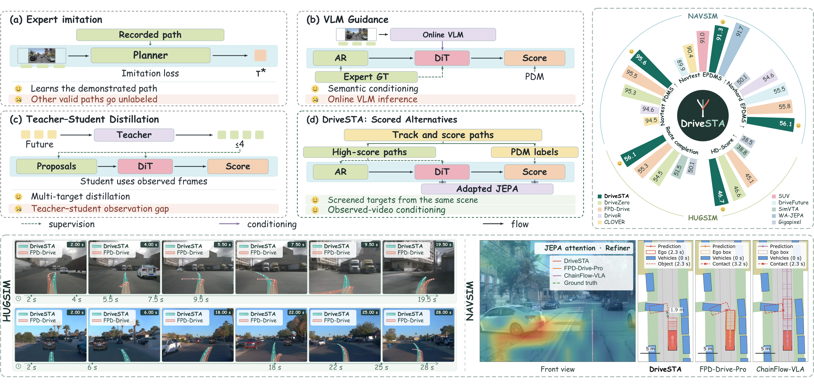

<p align="center">
  
</p>

<h1 align="center">Beyond a Single Human Demonstration:<br>Learning from Scored Trajectory Alternatives for End-to-End Driving</h1>

<p align="center">
   &nbsp;
  <a href="https://rtwotwo.github.io/DriveSTA/"></a> &nbsp;
  <a href="https://huggingface.co/Rtwotwo/DriveSTA"></a>
</p>

**DriveSTA** learns to generate, refine and score driving trajectories from scored alternatives to a single human demonstration. It combines proposal learning with JEPA-conditioned temporal refinement. **Base and Scale use one `DriveSTAAgent` and one `DriveSTAModel`; configuration selects the data mixture and refinement capability.**

[中文快速开始](docs/QUICKSTART_zh.md)

## DriveSTA at a Glance



Human driving logs record one executed trajectory per scene, while an end-to-end planner must generate and compare multiple feasible choices. **DriveSTA** turns a single demonstration into scored trajectory alternatives: we construct candidate paths, evaluate their execution, and retain diverse, high-quality targets to supervise planning. A shared Joint-Embedding Predictive Architecture (JEPA) encoder provides efficient temporal context from observed video. DriveSTA reaches **95.1 PDMS on NAVTEST** with NAVSIM-only training; DriveSTA-Scale, trained with real and synthetic data, achieves **95.6 PDMS**, along with **56.1 route completion** and **46.7 HD-Score** on HUGSIM.

## Method


## Start here

1. [Install the environment](docs/INSTALL.md).
2. [Prepare weights, driving data and caches](docs/DATA_PREPARATION.md).
3. [Run a single-scene prediction or benchmark evaluation](docs/INFERENCE.md).
4. [Train Base or Scale and resume training](docs/TRAINING.md).

For implementation details, see [code structure](docs/CODE_STRUCTURE.md) and [configuration reference](docs/MODEL_CONFIGS.md). Trajectory construction and recovery are documented in [MINING.md](docs/MINING.md), with [download verification and selective repair](docs/DOWNLOAD_VERIFY.md).

## Quick inference

After installation, run from the repository root:

```bash
python scripts/download_assets.py --profiles base
export OPENSCENE_DATA_ROOT=/path/to/openscene
source scripts/environment.sh
python -m navsim.planning.script.run_inference \
  --profile base --token SCENE_TOKEN --split test --device cuda \
  --output outputs/prediction.json
```

Replace `SCENE_TOKEN` with a token from your test logs. The command writes eight ego-frame `(x, y, heading)` poses at 0.5-second intervals, covering four seconds. Complete released checkpoints include their model backbones, so inference requires no separate pretrained-backbone initialization. Official PDMS additionally requires maps and metric caches; see the inference guide.

## Released profiles

| Profile | Model capability | Training scenes | Checkpoint |
| --- | --- | ---: | --- |
| `base_proposal` | Proposal generation and scoring | 103,263 real | `weights/Checkpoints/base_proposal.ckpt` |
| `base` | Proposals plus temporal refinement | 103,263 real | `weights/Checkpoints/base.ckpt` |
| `scale_proposal` | Proposal generation and scoring | 232,672 mixed | `weights/Checkpoints/scale_proposal.ckpt` |
| `scale` | Proposals plus temporal refinement | 232,672 mixed | `weights/Checkpoints/scale.ckpt` |

The complete trajectory release contains **308,119 scenes**: 103,288 Navtrainval scenes and 204,831 SimScale scenes. The fixed Scale recipe uses 103,263 eligible real scenes plus 129,409 synthetic scenes; it does not train on the whole archive. Original data identities, scene ordering and checkpoint tensor bytes are preserved.

Reported results include **95.55 NAVTEST PDMS** for DriveSTA-Scale, **91.32 NAVTEST EPDMS / 56.13 NAVHARD EPDMS** for its proposal planner, and **56.09 route completion / 46.69 HD-Score** for the refined planner on 345 HUGSIM scenarios. These are existing experimental results, not new benchmark runs for this packaging update.

## Training and evaluation entry points

```bash
# Inspect a fully composed recipe without launching training.
bash scripts/training/train_drivesta.sh base_proposal --cfg job --resolve
# Learn proposals, then refine them using the matching proposal checkpoint.
bash scripts/training/train_drivesta.sh base_proposal
bash scripts/training/train_drivesta.sh base \
  agent.checkpoint_path=/path/to/proposal_checkpoint.ckpt
# Evaluate a released full model on NAVTEST.
GPUS_PER_NODE=1 bash scripts/evaluation/run_drivesta_pdm_score_evaluation.sh base
```

## Repository layout

```text
navsim/agents/drivesta/               # Agent/model, builders, encoders, decoders, losses
navsim/planning/training/drivesta/    # Data readers, Lightning modules and training runners
navsim/planning/script/              # Training, single-scene inference and PDMS entry points
navsim/planning/script/config/       # Agent, training, evaluation and checkpoint configurations
navsim/evaluate/drivesta/            # Online labels and validation helpers
scripts/training/                   # Public training launcher
scripts/evaluation/                 # Public benchmark launcher
feedback/                           # Trajectory mining and recovery (drivesta_feedback package)
tests/                              # Model, resume, launcher and release IO regression tests
docs/                               # Tutorials, project page and release manifests
weights/                            # Checkpoints, initialization backbones and trajectory archives
```

The organization follows the NAVSIM conventions used by [ChainFlow-VLA](https://github.com/AFARI-Research/ChainFlow-VLA), while DriveSTA's public model and configuration names describe its own capabilities. Historical serialized identifiers are handled only at compatibility boundaries. Third-party library names and license notices retain their original attribution.

## Acknowledgements

Our code builds on [ChainFlow-VLA](https://github.com/AFARI-Research/ChainFlow-VLA), [FPD-Drive](https://github.com/CountNemoChan/FPD-Drive), [DrivoR](https://github.com/valeoai/DrivoR), and [NAVSIM](https://github.com/autonomousvision/navsim).

## License and validation

Original code is licensed under [Apache 2.0](LICENSE). See [third-party notices](third_party/README.md) for vendored code; external data and pretrained assets retain their own terms.

Current release checks and their limits are recorded in [VALIDATION.md](docs/VALIDATION.md). Full training and full benchmark reproduction are separate from release validation.
